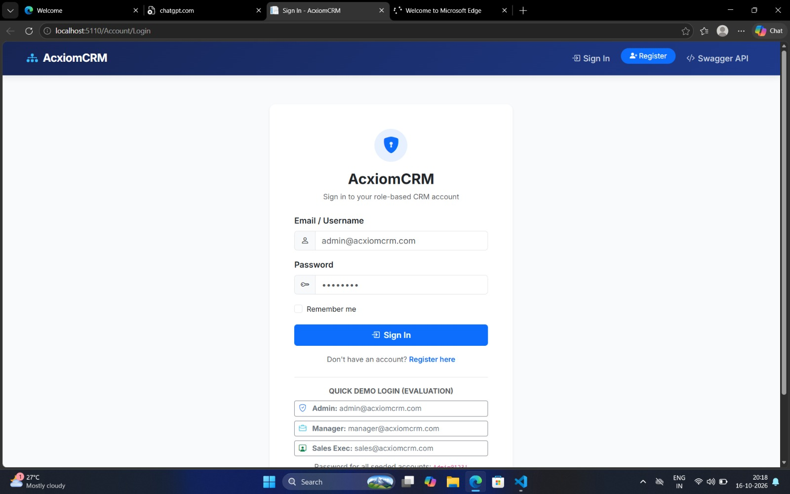

# AcxiomCRM — Enterprise Sales & CRM Platform

An enterprise-ready ASP.NET Core MVC application developed strictly according to the **AcxiomCRM Functional & Technical Project Documentation Assignment**.

---

## 📁 Project Location
* **Desktop Folder Path**: `C:\Users\Yash\Desktop\AcxiomCRM`
* **Direct 1-Click Runner**: Double-click `run_project.bat` to launch immediately!

---


.jpeg>)
.jpeg>)

## 🚀 How to Run
Open PowerShell or Command Prompt in this folder and execute:
```bash
dotnet run --launch-profile "http"
```
Once started, open your web browser:
* **Web Application**: [http://localhost:5110](http://localhost:5110)
* **REST API & Swagger Documentation**: [http://localhost:5110/swagger](http://localhost:5110/swagger)

---

## 👥 Pre-Configured Test Credentials
All accounts are pre-seeded in the database with the common password: **`Admin@123!`**

| Role | Username / Email | Password | Access Scope |
| :--- | :--- | :--- | :--- |
| **Admin** | `admin@acxiomcrm.com` | `Admin@123!` | Full unrestricted access to all data, users, roles, audit logs & system config |
| **Manager** | `manager@acxiomcrm.com` | `Admin@123!` | Team-wide customer, lead, and pipeline management; user view & analytics reports |
| **Sales Executive** | `sales@acxiomcrm.com` | `Admin@123!` | Assigned customers, leads, opportunities, follow-ups, and personal sales reports |

---

## 📋 Implemented Modules & Pages

1. **Authentication & Authorization** (`/Account/Login`, `/Account/Register`, `/Account/AccessDenied`)
   - ASP.NET Core Identity with secure password hashing.
   - Enforced password policy: minimum 8 characters, uppercase, lowercase, digit, special character.
   - Account lockout policy: locked out for 15 minutes after 5 consecutive failed login attempts.
   - Unauthorized page access protection (automatic redirect to login).
   - Quick-fill evaluation buttons for Admin, Manager, and Sales Executive.

2. **Dashboard** (`/` or `/Home/Index`)
   - KPI Cards: Total Customers, Total Leads, Open Leads, Total Opportunities, Open Opportunities, Won Opportunities, Lost Opportunities, Total Pipeline Value, Weighted Pipeline Value.
   - Chart.js Visualizations:
     * Lead Status Distribution (Doughnut Chart: New, Contacted, Qualified, Converted, Lost)
     * Opportunity Pipeline by Stage (Bar Chart)
     * Monthly Sales Trends (Line/Area Chart)
   - Actionable Follow-ups: Upcoming and Overdue follow-up lists with direct completion triggers.
   - Date range filters: Today, This Week, This Month, All Time.

3. **Customer Management** (`/Customers`)
   - Full CRUD operations with search, filters (Active/Inactive), and pagination.
   - Auto-generated customer codes (`CUST-0001`).
   - Duplicate checking on Email and Phone numbers (client-side and server-side).
   - 360° Customer History Tabs: Deals, Follow-Ups, Activities Timeline, and Audit Trail.

4. **Lead Management** (`/Leads`)
   - Lead capture with lead codes (`LEAD-0001`), source, priority, and expected value.
   - Status workflow: New → Contacted → Qualified → Converted / Lost.
   - **One-Click Lead Conversion** (`/Leads/Convert/{id}`): Converts a qualified lead into a Customer record and an active Opportunity deal with audit logging.

5. **Opportunity Management** (`/Opportunities`)
   - Pipeline stages: Qualification, Proposal, Negotiation, Won, Lost.
   - Derived weighted pipeline value calculation (`Amount × Probability / 100`).
   - Business validations:
     * Opportunity Amount must be greater than 0.
     * Probability must be between 0 and 100.
     * Expected Close Date cannot be in the past for active deals.
   - Visual stage progression timeline.

6. **Follow-Up & Activities** (`/FollowUps`, `/Activities`)
   - Channels: Calls, Meetings, Emails, and Tasks.
   - Business validation: Follow-up date cannot be earlier than today for new/planned activities.
   - Workflows: Complete with notes, Reschedule with new date, and Cancel.
   - Filtering for Upcoming and Overdue follow-ups.

7. **User & Role Management** (`/Users`)
   - Protected for Admin and Manager roles.
   - User creation with role assignment (`Admin`, `Manager`, `SalesExecutive`).
   - Lockout status monitor and 1-click Administrator **Unlock Account** action.
   - Safe password reset workflow.

8. **Audit Log & Reports** (`/AuditLogs`, `/Reports`)
   - Append-only audit trail capturing login success, failed attempts, lockouts, CRUD operations, and status changes.
   - Interactive Old Value vs New Value diff modal.
   - 7 Comprehensive Reports: Pipeline Report (Stage-wise & Owner-wise), Lead Conversion Report, Customer Directory, Follow-Up Report, Win/Loss Analysis, and User Activity Summary.
   - CSV Export for Pipeline, Customers, and Leads datasets.

9. **REST API & Swagger UI** (`/api/...`, `/swagger`)
   - Endpoints for Customers, Leads, Opportunities, Follow-Ups, and Pipeline data.
   - Uses DTOs instead of exposing database entities.
   - Standard HTTP status codes: `200 OK`, `201 Created`, `400 Bad Request`, `401 Unauthorized`, `403 Forbidden`, `409 Conflict`.
